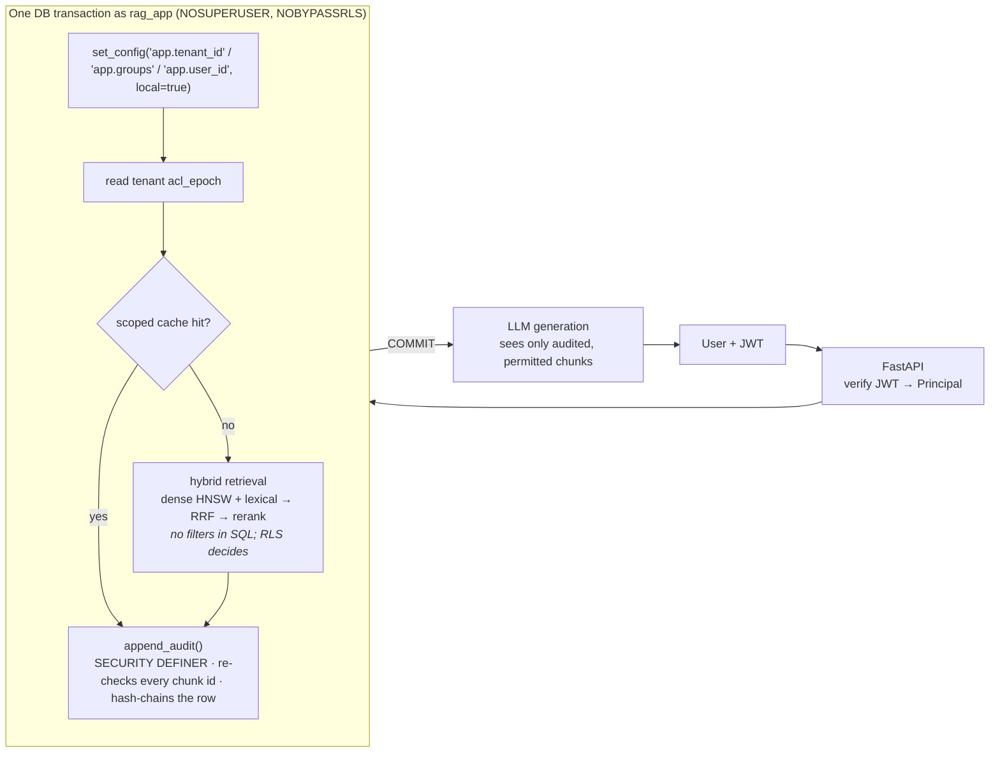

# secure-rag

**Permission-aware, multi-tenant RAG.** Every chunk inherits its document's tenant and access groups. Postgres row-level security filters retrieval by the caller's identity *before* anything reaches the LLM, and an append-only, hash-chained audit log records exactly what was retrieved for whom.

This is the problem every company hits the moment RAG touches internal data. HR's salary bands, the board's acquisition memo and the engineering runbook all live in the same index, and a single missing `WHERE` clause turns the assistant into a data leak.

> All companies, people and figures in `corpus/` are fictional.

---

## Results

### 1. Leakage: 0 of 856 adversarial queries leaked

Every restricted document carries a unique canary string (e.g. `CANARY-ACME-EXEC-KESTREL-…`). `eval/leakage.py` attacks each document from every user who must not read it. The attacks are the canary itself, the title, the opening of each paragraph, and injection-style prompts. **Before every attack, an authorised user asks the same question, so the semantic cache already holds the privileged answer.** The generator is an extractive mock that echoes its context verbatim, so any restricted chunk that reached it would print its canary.

| attack | queries | leaks |
|---|---|---|
| same tenant, other group | 376 | 0 |
| cross tenant | 480 | 0 |

A **negative control** (`test_detector_catches_leaks_when_rls_is_bypassed`) runs the same retrieval through the admin role, which bypasses RLS, and asserts the detector *does* fire. So the zero reflects the database enforcing access, not a detector that can't see leaks. A **utility check** asserts every insider can still retrieve every canary they're entitled to, so the filter isn't simply blocking everything.

### 2. The cost of filtering: HNSW post-filtering silently drops results

HNSW finds its nearest candidates first and applies filters afterwards. With pgvector's default `ef_search=40`, a user who can read 2% of the index gets back about **one** row out of the ten requested. RAG demos rarely show this, because their filters are never selective.

`eval/filtered_recall.py` builds a 20,000-chunk synthetic tenant and runs the *same* query through the real request scope (app role, RLS on) for users with 2%, 20% and 100% visibility. Ground truth is an exact scan under the same RLS policy, so recall measures only what the index loses.

| user visibility | mode | results returned | recall@10 | p50 ms |
|---|---|---|---|---|
| narrow (2%) | post-filter, ef_search=40 | 0.7/10 | 0.066 | 1.1 |
| narrow (2%) | post-filter, ef_search=200 | 3.1/10 | 0.310 | 2.2 |
| narrow (2%) | **iterative relaxed_order** | **10.0/10** | **0.918** | 6.1 |
| narrow (2%) | iterative strict_order | 10.0/10 | 0.856 | 5.5 |
| medium (20%) | post-filter, ef_search=40 | 7.8/10 | 0.774 | 1.2 |
| medium (20%) | iterative relaxed_order | 10.0/10 | 0.998 | 1.1 |
| broad (100%) | any mode | 10.0/10 | 1.000 | ~1.2 |

*Full table in `eval/results/`. Measured on PostgreSQL 16 + pgvector 0.8.1; vectors are synthetic and clustered on purpose, which isolates index behaviour from embedding quality.*

Takeaways:
- **Raising `ef_search` alone doesn't fix it.** A 5× larger candidate list still returns only 3 of 10 rows for the narrow user.
- **Iterative index scans (pgvector ≥ 0.8) do fix it**, at roughly 5× latency for very selective filters and no cost for broad ones. Recall for the narrow user is 0.92, not 1.0, because the scan is still approximate. The default here is `relaxed_order` (better recall in this test), re-sorted in a materialised CTE.
- **The tenant filter is a selectivity problem too.** While the 20k-chunk test tenant exists, the two real tenants are about 0.1% of the shared index. Without iterative scans, *every* user in a small tenant gets near-empty results. Past a certain scale, give large tenants their own partition or partial index.

### 3. Test suite: 38 tests against a real Postgres

The security properties live in Postgres, so the tests don't mock it. `pytest` covers RLS, leakage, the audit chain, cache scoping, and auth/API. It runs in about 5 seconds with dependency-free stand-in models, and runs in CI on every push.

---

## Architecture



**Request lifecycle**, in `service.py`:

1. The JWT becomes a validated `Principal` (user, tenant, groups). Identifiers are restricted to `[a-z0-9_-]`, so a group named `hr,exec` can't smuggle a second group into the comma-joined setting.
2. A transaction opens on a pooled `rag_app` connection, and the identity is set with `set_config(..., true)`, the parameterised form of `SET LOCAL`.
3. The cache is looked up under a key of `tenant + groups + acl_epoch`. On a miss, hybrid retrieval runs.
4. `append_audit()` writes the audit row **inside the same transaction**. It re-validates every chunk id against the current ACL and raises if any is unreadable, which aborts the request before generation.
5. COMMIT. The audit record is now durable even if the LLM call fails, and no DB connection is held open during a slow model call.
6. The generator sees only the chunks that were just audited.

---

## Design decisions

**Enforce in the database, not in application code.** `retrieval.py` contains no tenant or ACL filters at all. RLS policies on `chunks`, `documents` and `tenants` read the caller's identity from transaction-local settings. A new query that forgets a filter therefore still can't see foreign rows, which `test_unfiltered_select_returns_no_foreign_canaries` checks literally. If the settings are missing, the helper functions return NULL or an empty array and every policy is false, so the system fails closed.

**The app role is deliberately weak.** Superusers and table owners bypass RLS, which is the most common way RLS deployments quietly do nothing. `rag_app` is `NOSUPERUSER NOBYPASSRLS`, owns no tables, has `SELECT` only on the corpus, and cannot read the audit log. `test_app_role_cannot_bypass_rls` fails the build if the deployment connects as the wrong role.

**`SET LOCAL`, because of connection pooling.** A session-level `SET` would leave the previous user's identity on a pooled connection. Transaction-local settings vanish at commit, so the next request on that connection sees zero rows until it sets its own identity (`test_identity_does_not_survive_the_transaction`).

**ACLs on documents, not copied onto chunks.** Chunks join to their document's `acl_groups`. Revoking access is a one-row `UPDATE` that applies to the very next query (`test_revocation_is_immediate`), with no re-embedding or re-indexing. The trade-off is a per-candidate `EXISTS` lookup during the scan. That is cheap at this scale, but denormalising `acl_groups` onto chunks would be the move for very large corpora, at the price of bulk updates on revocation. A composite foreign key `(doc_id, tenant_id)` makes it impossible for a chunk to claim a different tenant than its document.

**Audit identity comes from the database.** `append_audit()` reads user, tenant and groups from the same session settings RLS used, so the log can't disagree with the filter that produced the result. It is `SECURITY DEFINER`: the app can append, but can't read, update or delete. Triggers block `UPDATE`, `DELETE` and `TRUNCATE` even for the admin. Each row stores the SHA-256 of the previous row's hash plus a canonical payload, and `verify_audit_chain()` finds the first altered row (`test_tampering_is_detected`). The query is stored as a hash by default (`AUDIT_STORE_QUERY=false`), because raw questions can themselves be sensitive.

**The cache is scoped, or it's a side door.** A global semantic cache would hand the exec's cached answer to the next person who asks something similar, without ever touching retrieval. Entries are keyed by tenant, sorted groups and the tenant's `acl_epoch`. A trigger bumps the epoch on every document change, so revocation orphans old entries instantly. Users with identical group sets share entries, which is correct because ACLs are group-based. Cache hits are still audited, and their chunk ids still pass the tripwire.

**Lexical search doesn't leak corpus statistics.** Postgres `ts_rank_cd` scores each document on its own, with no corpus-wide IDF. A shared BM25 index computes term statistics across *all* tenants' documents, which is a subtle cross-tenant side channel. Using Postgres full-text search avoids it.

---

## Threat model

**Protects against:**
- application bugs that omit a tenant or ACL filter
- cross-tenant and cross-group retrieval, including through the semantic cache
- prompt injection extracting restricted content: the LLM never receives chunks the caller can't read
- stale permissions after revocation, in both the index and the cache
- silent edits to the audit log

**Does not protect against:**
- **A compromised application process.** It holds `rag_app` credentials and can set any `app.tenant_id`. The guarantee is "the app can't *accidentally* leak", not "the app is untrusted". Hardening options are per-tenant DB roles, or having the database verify a signed identity token itself.
- **Wrong ACLs at ingestion.** If a document is tagged `all`, everyone can read it. The system enforces ACLs; it doesn't infer them.
- **A superuser rewriting the entire audit chain consistently.** Anchoring the head hash externally fixes this; `cli audit-head` prints it.
- **Exposure to the LLM provider.** Retrieved context is sent to Groq, so self-host the model if that's out of policy.
- **Timing side channels.** Very selective filters are measurably slower (see the table above).

---

## Bug found along the way

The first run of the filtered-recall eval reported the medium user getting **7.8 of 10** results with **0.948 recall**, which is impossible: recall can't exceed results returned divided by k. The cause was the ground-truth "exact" query. It disabled index scans with `SET LOCAL enable_indexscan = off`, but psycopg automatically prepares statements that run repeatedly, and Postgres reuses a cached *generic plan* regardless of later planner settings. The "exact" search was quietly running on the HNSW index too.

The fix was to make exactness structural. The ground-truth query orders by `(embedding <=> q) + 0`, which no index can serve, and the script asserts via `EXPLAIN` that the benchmark query *uses* HNSW and the ground-truth query *doesn't*. Lesson: don't trust a planner setting to stay in effect across prepared statements.

---

## Quickstart

Requires Docker and Python 3.10+.

```bash
git clone https://github.com/zahrafatima9432/secure-rag && cd secure-rag
python -m venv .venv && source .venv/bin/activate      # Windows: .venv\Scripts\activate
pip install -e ".[models,dev]"
cp .env.example .env                                    # Windows: copy .env.example .env
#   then set JWT_SECRET and GROQ_API_KEY (or GENERATOR=mock)

docker compose up -d
python -m secure_rag.cli init-db
python -m secure_rag.cli ingest
```

**Same question, three users:**

```bash
python -m secure_rag.cli ask carol "What is the proposed price for Project Kestrel?"   # exec: answers
python -m secure_rag.cli ask dave  "What is the proposed price for Project Kestrel?"   # all-staff: no access
python -m secure_rag.cli ask hana  "What is the proposed price for Project Kestrel?"   # other tenant: no access
```

**Revocation and audit:**

```bash
python -m secure_rag.cli revoke acme/hr-salary-bands hr     # bob loses access on his next query
python -m secure_rag.cli ask bob "senior engineer salary band"
python -m secure_rag.cli grant acme/hr-salary-bands hr
python -m secure_rag.cli audit-tail -n 5
python -m secure_rag.cli audit-verify
```

**API:**

```bash
uvicorn secure_rag.api:app --reload
TOKEN=$(python -m secure_rag.cli token bob)
curl -s localhost:8000/query -H "Authorization: Bearer $TOKEN" \
     -H "Content-Type: application/json" -d '{"question":"What is the 2026 merit budget?"}'
```

**Tests and evals:**

```bash
pytest -v                          # uses a separate <db>_test database and stand-in models
python eval/leakage.py             # adversarial canary sweep (add --groq to use the real LLM)
python eval/filtered_recall.py     # HNSW + RLS selectivity experiment
python eval/quality.py             # per-user retrieval quality + denied-question check
```

---

## Repo layout

```
sql/schema.sql            tables, RLS policies, app role, audit function + hash chain
src/secure_rag/
  db.py                   admin vs app connections, request_scope (SET LOCAL)
  retrieval.py            dense + lexical + RRF + rerank; no filters by design
  service.py              scope → cache/retrieve → audit → commit → generate
  cache.py                permission-scoped semantic cache
  auth.py, api.py         JWT → Principal, FastAPI
  ingest.py               corpus loader, chunker, ingestion
  models.py               bge embedder/reranker, Groq; hash/mock stand-ins
  cli.py
corpus/                   2 fictional tenants, 14 documents, 10 users, canaries
eval/                     leakage, filtered_recall, quality + gold set
tests/                    38 tests against real Postgres
```

## Limitations and next steps

- **Classification levels** (public / internal / confidential), as an attribute-based layer on top of groups. This is the planned next stage.
- Per-user ACLs, such as documents shared with named individuals. These would need `user_id` in the cache key.
- Verify IdP tokens via JWKS (RS256) instead of the demo's shared-secret HS256.
- Move the cache to Redis or pgvector with the same key structure, so it survives restarts and scales across workers.
- Partition large tenants, or give them their own index, rather than relying on iterative scans alone.
- The quality eval is intentionally small. Each user can read 1–5 documents, so hit@5 is easy. Its job is to show that filtering doesn't break answers for restricted roles; retrieval quality at scale is covered in my [production RAG project](https://github.com/zahrafatima9432).
